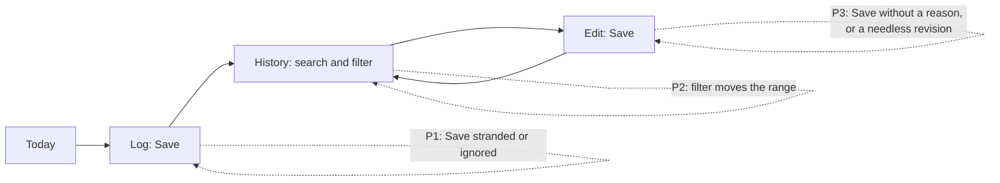

# Core flow round 1 — 15 October 2026: Save and Find never fail silently

Baseline: `main` at `1163b61` (0.7.4 expressive pass, #126). Release state is
not changed by this round. The last App Store Connect evidence available is the
read-only inspect run of the public-release workflow on 12 October 2026
12:35 UTC (run 38150398210): 0.7.3 build 1079.5 *Waiting for Review*, 0.7.2
(1076.3) and 0.7.1 (1051.1) *Ready for Distribution*. Anything after that
moment is unknown here.

## Method

Three read-only source audits walked Today, Log and History, each finding
re-checked against the code before it was accepted. Findings already fixed or
deferred in [AUDIT_2026-09-25.md](AUDIT_2026-09-25.md) were not reopened. This
round takes the three most harmful problems that share one cause: on the way
from logging an entry to finding and correcting it, Save or Find could stop
working and say nothing.

## P1 — Log: Save could be stranded or ignored

| Evidence on `main` | Effect |
|---|---|
| `QuickLogSheet.swift:678` — `canSave` required `smartState.issues.isEmpty`; a reading refused as *several transactions* or *too long* (`QuickLogUnderstandingFill.swift:6-10`) sets issues no field edit clears (`QuickLogSmartState.swift:34-45`), and editing or deleting the Smart Entry text cleared nothing. The issues are saved with the draft. | After pasting several lines and tapping Fill, the typed entry could not be saved, even after deleting the text, until *Clear entry*. *Review each line* then asked to "Save or clear this entry first" while Save was dimmed. |
| `QuickLogEntryDuplicateReview.swift:7` — Save returned silently while an input method was still composing a word. | Pinyin, Kana or Hangul users tapped Save and nothing happened. |

**Change.** A refused reading fills no field, so it no longer gates Save
(`QuickLogSmartState.blocksSave`); its notice stays until the Smart Entry text
changes (`smartTextChanged()`), then disappears. Issues from a reading that did
fill fields still wait for their field. Save during composition says *Finish
choosing the current word, then save.* / *请先完成当前文字选字，再保存。*

**Acceptance.** Several lines → Fill → the fields typed by hand save; deleting
the phrase removes the notice; an ambiguous-category reading still holds Save
until a category is chosen; Save during composition shows the message and
saves nothing.

## P2 — History: applying a filter moved the range

| Evidence on `main` | Effect |
|---|---|
| `HistoryView.swift:760` — applying the filter sheet always set `quickRange = nil`. | Choosing only a category on *Today* turned the range into *Custom range* with today's dates: it stopped rolling at midnight, the badge counted the dates as a filter, and a search no longer looked through every date (`HistorySearchScopePolicy` leaves custom ranges alone). |
| `HistoryView.swift:800` — Clear (×) showed whenever any date was set, and `clearHistoryFilters()` (`:855`) always jumped to *All*. | On the default *Today* a Clear button appeared with nothing to clear; clearing a search or a category also threw away the chosen range. |
| `HistoryView.swift:551` — account and budget drill-ins offered *Clear filters* in their empty state. | Tapping it removed the drill-in's own account or category scope and listed the whole book under that account's title. |

**Change.** `HistoryFilterScopePolicy` keeps Today, 7 days, Month or All unless
the sheet's dates changed (compared by calendar day); removing both dates is
*All*, not an empty custom range. Clear appears only for a search or a filter
the range row does not show, and leaves the range as ending the search would:
the range a search widened to All comes back, a range chosen during the search
stays, a custom range clears to All. Drill-ins offer *Clear search* only.

**Acceptance.** On Today, filter to a category → range stays Today, badge 1,
search "lunch" finds every date and clearing it returns to Today. Default
Today shows no ×. Month + category → × → Month without the category. An empty
account drill-in never offers to leave its account.

## P3 — Edit: Save was less trustworthy than Log's

| Evidence on `main` | Effect |
|---|---|
| `TransactionEditBody.swift:23` — the amount field had no field validation; `canSave` (`TransactionEditView.swift:257`) did not apply the 15-digit new-write ceiling. | "12.345" in a USD entry, "abc" or "0" only dimmed Save; a too-large amount was accepted by the form and refused by the model with an alert. |
| `TransactionEditBody.swift:450` — `save()` always wrote; replacement takes a new identity and `revisedAt` (`AppModelJournalEditing.swift:252-253`). | Opening an entry and tapping Save without a change added a revision record, a "Last edited" stamp and a new ID. |
| `save()` had no in-flight or composition guard. | A second tap during a save could raise "Finish the current save before recording another transaction." over a save that succeeded; composing text could be saved unfinished. |

**Change.** `MoneyInputIssue` is the one amount rule for Log and the editor
(shape, currency precision, new-write ceiling, focused-prefix tolerance), worded
by the matching `MoneyError`, so Log's messages are unchanged and the editor
shows the same message under the amount, received-amount and split-line
fields. Untouched
legacy amounts stay saveable. `TransactionEditSavePolicy` makes Save close an
unchanged form without writing, ignore a second tap while saving, and ask to
finish a composed word first.

**Acceptance.** Edit a USD entry to "12.345" → *USD supports up to 2 decimal
places.* under the field and Save dimmed; "12.34" saves exactly 12.34. Save on
an unchanged entry closes and leaves no revision. A refused model save leaves
the entry as it was and the corrected form saves once.

## Guardrails kept

- Amounts stay `Decimal` end to end; no ledger, posting, currency or migration
  rule changed. The model's own new-write validation and mutation gate are
  unchanged and remain the final authority.
- No new dependency, permission, telemetry, network or storage. One new
  bilingual string; an existing unused one (`history.clear_search`) is now used.
- No reviewed Quick Log digest changed; every `Scripts/validate_*.py` passes.

## Verification

- 13 new App tests in `RoundTripReliabilityTests` (amount precision and
  ceilings across USD/JPY/KWD, legacy preservation, unchanged wording, refused
  readings, filter and Clear scope, the save policy, overlapping edit saves
  writing one revision, a refused edit leaving the entry intact then saving
  the exact correction, and a rendered Log in English and Chinese at 390 and
  320 pt).
- Swift was not compiled or run in the authoring environment (Linux). Compile,
  unit and render evidence comes from the pull request's macOS CI.

## Device checklist (owner, signed build)

1. Paste two lines with amounts into Smart Entry, tap Fill, type an amount and
   category, Save. Delete the phrase: the notice goes.
2. Chinese Pinyin: type a merchant, leave the candidate bar open, tap Save.
3. History on Today: filter to a category, search a word from last month,
   clear the search. Check the badge, the range and the ×.
4. Edit a transaction: type "12.345", "abc", then a valid amount; tap Save on
   an untouched entry and confirm no "Last edited" appears.
5. VoiceOver reads the field messages after the amount field; Larger Text
   wraps them.

## Next round (not changed here)

- Today: pinned rows may not redraw when amounts are hidden (they do not
  observe the setting); five places still speak "*****" to VoiceOver; the
  over-budget hero says "Left this month −S$150" in amber; several rows do not
  stack at accessibility sizes (part of U3).
- History: editing or deleting past the first page returns to page 1; amounts
  written as the row shows them ("28.80", "$12") are not found; parent
  category names and split memos are shown but not searched; swipe-delete
  omits the reimbursement-claim warning the editor gives.
- Log: the Saved banner truncates at accessibility sizes; the date resets after
  every save; a leading "." and pasted grouped amounts are refused; a dimmed
  Save gives VoiceOver no reason; Undo's timer ignores Switch and Voice Control.
