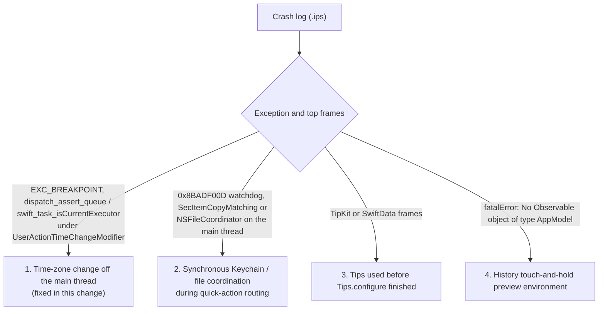

# Crash triage: TestFlight 0.7.3 (1077.1), 24 October 2026

## Report

An external tester sent TestFlight feedback at displayed time 14:46
(display timezone not independently verified): "崩溃啦" ("it
crashed"). No screenshot or steps. The crash log has **not** been retrieved
yet, so the root cause below is unconfirmed.

| Field | Value | Why it matters |
|---|---|---|
| Build | 0.7.3 (1077.1), source `d286cbb` | First 0.7.3 candidate (29 September); 76 commits behind `main` at the time of writing |
| Device | iPhone 17 Pro, iOS 26.2.1, arm64e | Older than the iOS 26.5 and iOS 27 the device and CI checks use |
| Time since boot | 0 min | The crash happened within about a minute of a restart |
| Locale, zone | Chinese, Simplified (Singapore); Singapore Standard Time | Chinese UI, SG region, SGD, UTC+8 |
| Battery, network | 25%, cellular | Time and time zone come from the carrier |

The owner's check of 1077.1 on a physical iPhone (iOS 27) opened every tab
without a crash, so a crash on every launch is unlikely.

## Method

Static review of the exact source of 1077.1 (no Swift toolchain was available,
so nothing was built or run): the launch path, every explicit trap, and three
independent audits of arithmetic and collection traps, concurrency and
framework traps, and launch after a restart. Each candidate was re-read
against its callers before it was kept.

## Reviewed paths (not an exhaustive exclusion of crash causes)

| Class | Evidence |
|---|---|
| Translated format strings | Every `%` specifier, positional ones included, matches between en and zh-Hans in all three `.xcstrings` catalogs (228 values); every `String(format:)` call passes matching argument types |
| Uptime arithmetic | No use of `systemUptime`, `DispatchTime.uptimeNanoseconds` or similar anywhere |
| Raw-key database move (#104) | Every failure is caught, closes or reopens the legacy book, and defers a retry |
| Duplicate keys | All 74 `Dictionary(uniqueKeysWithValues:)` sites are keyed by values made unique at load (primary key plus `value.id.uuidString == record.id`) or checked before use |
| Arithmetic, ranges, subscripts | Reviewed guards in the ordinary paths, including calendar ranges; not all conversion boundaries are safe. The independently verified import Date-to-Int64 trap below is an exception. |
| Notification, Face ID and delegate callbacks | All `@Sendable`, `nonisolated` or delivered on the main thread (the #113 class) |
| Foundation Models | Availability checked before use; errors caught; ordinals bounds-checked |
| Fresh install in Chinese | All 18 account and 35 category preset labels are distinct in en and zh-Hans; record IDs, not names, key the dictionaries |

## Candidates, most likely first

1. **A time-zone change delivered off the main thread** (fixed here). Log and
   the transaction editor refresh their time context from
   `NSSystemTimeZoneDidChange` through `onReceive`
   (`QuickLogSheet.swift:61-77` at `d286cbb`). NotificationCenter delivers on
   the posting thread and `onReceive` runs its action there. The action calls
   main-actor code, so Swift 6's isolation check traps (`EXC_BREAKPOINT`) if
   the notification is posted from a background thread. This is the #113
   failure class, which this app has already hit once. It fits a restart over
   cellular, when the carrier time zone is settled, while Log is open.
   Unverified: which thread iOS 26.2 posts this notification on.
2. **Synchronous Keychain read on the main thread during routing.**
   `quickActionRoutingDisposition` (`MoneyUpQuickActionRouting.swift:27`) and
   `handleDeepLink` (`AppModelLifecycle.swift`) call
   `dataEraseIntent.isPending()`, a synchronous `SecItemCopyMatching`, on the
   main actor, although `AppModelDependencies.swift` says this read must stay
   off the launch thread. `validate_launch_safety.py` looks only for the
   literal call in three files, so it does not see this one. A watchdog
   termination needs a multi-second stall of the security service, which is
   more likely just after a restart. Not changed here.
3. **Tips used before `Tips.configure` finished.** `MoneyUpTips.configure()`
   runs `Tips.configure` in a utility-priority detached task, while Log reads
   `ScanReceiptTip().status` and donates on the main thread. A launch straight
   into Log just after a restart can reach the tip first. What TipKit does in
   that window is unverified. Not changed here.
4. **History touch-and-hold preview** (new in 0.7.3). The preview renders
   `TransactionRow`, which requires `@Environment(AppModel.self)`. If iOS does
   not pass the environment into context-menu previews, SwiftUI stops the app.
   No test performs this gesture. Not changed here.

## Change

`UserActionTimeChange.notifications(from:)` merges the significant-time and
time-zone notifications and delivers them on the main queue; the Log and
editor modifier subscribes to it. The behaviour on the main thread is
unchanged. `TransactionPresentationTests.testTimeChangesPostedOffTheMainThreadArriveOnIt`
posts both notifications from a background task on a private centre and
requires both deliveries on the main thread; without the hop they arrive on
the posting thread and the test fails.

## Found on the way (not crashes)

- **A saved Log draft can be deleted at launch.** Startup assigns `store`
  (`AppModelKeyCliffRecovery.swift:73`) before `load` restores the draft
  (`AppModelRecovery.swift:555`), and startup is not a lifecycle mutation. If
  the scene goes inactive in that window (Control Center, a system alert),
  `sceneDidLeaveActive` calls `flushQuickLogDraftImmediately()` while
  `quickLogDraft` is still `nil`, which removes the stored draft
  (`AppModelJournalProjection.swift:623-627`). Found by reading; not
  reproduced.
- **Launch before first unlock.** The app never checks
  `isProtectedDataAvailable`. If iOS runs `App.init` before the first unlock
  (prewarming or a background intent), the widget snapshot migration and the
  reminder refresh read empty App Group defaults. Whether that overwrites
  stored state is unverified.

## Next steps

### Independent import-date safety correction (26–28 October)

`ImportedTransaction` accepts arbitrary `Date` values. Before `JournalEntry`
validation, `AppModelImport.transactionImportDuplicateKey` converted floored
Unix seconds with a trapping `Int64` initializer. The reviewed candidate uses
`Int64(exactly:)`, returning no semantic key for nonfinite or out-of-range
seconds. A newly accepted invalid row releases its reserved fingerprint and
is counted as skipped before category creation or persistence. Existing
fingerprint duplicates retain precedence; valid key encoding is unchanged.

The separate date-guard candidate on `e4ab8ad` passed five new regression tests
and four repeated-import tests on 26 October (Xcode 27.0, iPhone 17 Pro
simulator, iOS 26.5, warnings as errors). Its broader run was interrupted by
disk exhaustion and is not a complete-suite verdict. These results do not
cover the combined notification-plus-date-guard candidate: that exact source
still needs fresh native CI. Neither safety correction establishes the cause
of the reported 1077.1 crash. Ordinary CSV reachability of an unsafe date and
the original crash stack remain unverified.

### Incident evidence still needed

1. Retrieve the crash log: Xcode › Organizer › Crashes (build 1077.1, the
   Feedback inspector shows the tester's comment), App Store Connect ›
   TestFlight › Crashes, or the App Store Connect API
   (`GET /v1/betaFeedbackCrashSubmissions/{id}/crashLog`). The flowchart
   above maps its exception to a candidate.
2. One-minute device check of candidate 1 on 1077.1: open Log, then in
   Settings › General › Date & Time turn off Set Automatically, pick another
   time zone and return to MoneyUp. Repeat on a build with this change.
3. Ask external testers to move past 1077.1. 0.7.3 (1079.5) and 0.7.4 carry
   the later 0.7.3 fixes, but neither contains this change; it needs a new
   build.
