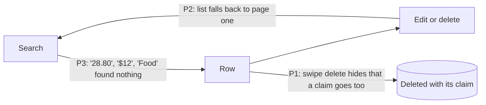

# Core flow round 3 — 15 October 2026: find, correct and delete in History

Baseline: `claude/core-flow-polish` at `9c51f7f` (round 1, #129), itself on
`main` at `1163b61`. This round is stacked on round 1 because both change
`HistoryView.swift`; it merges cleanly after #129, or onto `main` with #129's
commits. Release state is not changed; App Store Connect state after the
evidence recorded in [CORE_FLOW_ROUND_2026-10-15.md](CORE_FLOW_ROUND_2026-10-15.md)
is unknown.

## Why this round

History is where an entry is found again and put right. Two read-only audits
re-checked the open items from rounds 1 and 2 against the source; three
History problems were confirmed and taken together, because each breaks the
same loop:

## P1 — Swipe delete did not say a claim would be deleted

| Evidence (`9c51f7f`) | Effect |
|---|---|
| The editor names a linked reimbursement claim (`TransactionEditBody.swift`, `allowance.claim.delete_confirmation_detail`); History's swipe delete (`HistoryView.swift`, the `entryPendingDeletion` dialog) and Calendar's (`CalendarView.swift:211-226`) always said `transaction.delete_detail`. `AppModel.deleteEntry` removes the linked usage and its claim status (`AppModelJournalMutations.swift`, `allowancesAfterDeletingLinkedEntry`), with no confirmation gate of its own. | Swiping away a claimed expense permanently deleted the claim's evidence and its approved or reimbursed status after a warning that spoke only of balances, budgets and reports. |

**Change.** `AppModel.hasLinkedAllowanceClaim(entryID:)` and
`TransactionDeleteConfirmation` give the editor, History and Calendar one
wording rule: an entry with a claim gets *This permanently deletes the expense
and its claim evidence, including its current status…* / *这会永久删除该支出及其申请凭证（包括当前状态）…*.
The delete itself is unchanged.

**Acceptance.** Swipe-delete a claimed expense in History or Calendar: the
dialog names the claim. An ordinary expense: the usual wording.

## P2 — An edit or a delete deep in the list returned to page one

| Evidence (`9c51f7f`) | Effect |
|---|---|
| An edit or delete invalidates the journal projection; History's `.onChange(of: journalRecentEntriesAreCurrent)` bumps `refreshGeneration`, and `reloadHistory()` fetched one page (`historyPage(query:)`, 80 rows) and replaced `loadedEntries` with it. | Working through older entries, every correction dropped every row past the 80th; the list jumped to the end of page one and the person had to scroll back. |

**Change.** `AppModel.historyPage(query:coveringAtLeast:)` reads ordinary
pages until it holds at least the rows already loaded (stopping at the end of
the book, and if the book is replaced between pages). History passes the
loaded row count when it refreshes the same search and filters, and zero for a
new query, so a first visit is still one page.

**Acceptance.** Scroll to row 200, edit or delete it: the rows around it stay,
in the same order, and scrolling on continues from there.

## P3 — Search did not find what a row shows

| Evidence (`9c51f7f`) | Effect |
|---|---|
| `HistoryQuery.matches` (`Sources/MoneyUpCore/HistoryQuery.swift`) searched each amount only as `28.8 SGD` and `1,234.5 SGD` (no trailing zero, no symbol, code last); rows show `$28.80` or `SGD 1,234.50` (`DisplayFormatting.swift`, currency formatter at the currency's minor units). Account names were searched, but not their parents. | Typing the figure a row shows ("28.80", "$12", "1,234.50", "SGD 12.00", "-12.00") found nothing; "Food" did not find entries filed under "Food › Groceries". |

**Change.** For a query with a digit, each amount is also written the ways a
row shows it, in the same locale: currency symbol, ISO code, grouped and plain
numbers at the currency's minor units; no-break spaces count as spaces, and a
leading sign is ignored because amounts are stored unsigned. Forms are built
once per amount and currency in a search pass. A category's parents' names
are searched with its own (a cycle in damaged data ends the walk).

**Acceptance.** "28.80", "$12", "1,234.50", "SGD 1,234.50", "-$12.00",
"¥1,200", German "1.234,50" find their entries; "1,234.51" and "12.01" do not;
"Food" finds a Groceries entry. "SGD" alone still finds SGD entries.

## Guardrails kept

- No ledger, posting, allowance, claim or delete rule changed; the delete
  confirmation only says more. Amounts stay `Decimal`; search formats copies
  for matching and never parses the query into an amount.
- No dependency, permission, telemetry, network or stored-format change; no
  new strings (the claim wording already existed).
- A search scans the whole book for its totals, so the query is prepared once
  per search, the displayed forms of an amount are built only when the
  query's digits occur in that amount's digits, and each amount's forms are
  cached for the pass: a 10,000-entry amount search with no repeated amount is
  guarded at < 2 s in CI, beside the existing 10,000-entry text search guard.

## Verification

- Core (`HistoryQueryTests`, +3): amounts as rows show them across SGD, USD
  and JPY in `en_US`, EUR-style grouping in `de_DE`, signs, no-break spaces,
  near misses; parent category names and a parent cycle; the 10,000-entry
  amount-search guard.
- App (`HistoryFindAndFixTests`, +2): the delete wording for a claimed and an
  ordinary expense, in both languages, and that delete still removes the
  claim; a refresh after three pages returns the same 240 rows in order,
  continues to the last 10, reads one page for a new list, reads 250 once,
  and keeps every other reached row after deleting row 200.
- Swift was not compiled or run in the authoring environment (Linux); every
  `Scripts/validate_*.py` passes there. Compile and test evidence comes from
  the pull request's macOS CI.

## Device checklist (owner, signed build)

1. With a reimbursement allowance, log a claimed expense; in History and in
   Calendar swipe to delete it and read the dialog (English and Chinese).
2. In a book with a few hundred entries, scroll History past 200 rows, edit
   one and save, then delete one: the list stays where it was.
3. Search a row's amount exactly as shown, with symbol or code; search a
   parent category name.

## Next round (verified, not changed here)

- Log: the entry date resets to now after every save, so several entries for
  one past day each need the date picked again (needs a "carried date" the
  draft rules respect); a dimmed Save gives VoiceOver no reason; the Saved
  banner truncates its amount at accessibility sizes, and its Undo timer
  pauses only for VoiceOver, not Switch Control. Several of these touch
  digest-pinned Quick Log code and need a reviewed pin update.
- Log: unambiguous grouped amounts ("1,234.50" in `en_US`) and a leading
  separator (".5") are refused in the amount field, while Smart Entry accepts
  grouping; ambiguous single-separator text stays refused by design (M1).
- About thirty secondary views format amounts without observing the hide
  preference (round 2 residual).
