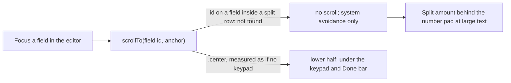

# Core flow round 6 — 15 October 2026: the keyboard never covers the field being typed into

Baseline: `claude/history-find-fix` at `a3c2014` (round 3, #131, on round 1,
#129), which changes the same transaction editor; stacked on it for that
reason. Release state is not changed; App Store Connect state after the
evidence recorded in [CORE_FLOW_ROUND_2026-10-15.md](CORE_FLOW_ROUND_2026-10-15.md)
is unknown.

## Why this round

The brief asks that the keyboard never cover an input. The requirements
matrix listed R071-KEYBOARD as `AUTO-PENDING`: nothing measured where a
focused field ends up. A read-only audit of Log, History and the transaction
editor found two places in the editor (opened from History) that differ from
Log, where the same problems were fixed on 24 September
([TESTING.md](TESTING.md), "Bugs these layers found"):

Reduce Motion was audited in the same pass: every motion these flows own goes
through `MoneyUpMotion` and stops under Reduce Motion, so it needed no change.
Brand colours keep at least 4.7:1 for text in light and dark.

## P1 — A split line's amount went behind the number pad

| Evidence | Effect |
|---|---|
| `TransactionEditView.swift`: `.id(FieldFocus.splitAmount)` and `.id(FieldFocus.splitMemo)` sat on fields inside the split row's `VStack`; a Form resolves `scrollTo` by row, so the editor's scroll found nothing. Reproduced at Accessibility XL on iOS 26.5 (journey below): split 2 amount at y 550–600 with the clear area ending at y 583. | The number pad covers the field; only the cursor's top shows, so the amount being typed cannot be read. |

**Change.** As in Log: the row carries the id, and a line's note scrolls to
its line's row (`FieldFocus.scrollTarget`).

## P2 — The editor centred the focused field

| Evidence | Effect |
|---|---|
| `TransactionEditBody.swift` scrolled to `anchor: .center`; Log's `QuickLogFocusScrollPolicy` records that the centre is measured as if the keypad were absent and moved Log to the upper third. | With the row ids found (P1), centring a split row would put its note, at the row's foot, under the text keyboard and its Done bar. Payee and note were not covered at the sizes measured. |

**Change.** The editor uses Log's anchor, the upper third
(`QuickLogFocusScrollPolicy.anchor`), for every field.

## Guardrails kept

- Scroll position only: no ledger, money, formatting, masking or storage
  change; no new strings, dependencies or permissions.
- Log is unchanged; it already did both.

## Verification

Reproduction first (`4c747e1`, `0f8e53d`, `661065e`: tests only,
app code = #131), iOS 26.5, iPhone 17 Pro; each check focuses the field,
waits for the screen's two scroll passes, and measures the field's frame
against the keyboard top, any bar riding it, the navigation bar and Log's
Save bar:

| Journey | Before |
|---|---|
| Editor, default size: split 2 amount and note, payee, note | pass |
| Editor, Accessibility XL | **split 2 amount covered** (run 1); split 2 note, payee, note pass (runs 1–2) |
| Log, Accessibility XL: payee, note | pass (run 2) |

The first two runs also exposed three test defects (fields never brought
into a lazy form, a single tap with no retry, and checks out of form order);
each was fixed in the test only before the app change.

With the change: the same three journeys, and
`TransactionPresentationTests.testEditorKeyboardScrollTargetsTheRowOfEveryEditableField`.

Swift was not compiled or run in the authoring environment (Linux); every
`Scripts/validate_*.py` passes there.

## Device checklist (owner, signed build)

1. Largest text sizes: open an entry from History, turn on Split across
   categories, tap the second line's amount and type; the digits stay in
   sight. Then its note, the payee and the note.
2. iPhone SE (667 pt), default size: the same steps.
3. Hardware keyboard attached: nothing jumps when a field is focused.

## Not changed (next)

- Log's and the editor's amount and received-amount ids still sit on the
  field inside its row. The amount is at the top of the form and was never
  covered; the received amount (transfers between currencies) was not
  measured.
- No CI lane runs on a 667-pt iPhone SE; the journeys run on the iPhone 17
  Pro, where large text stands in for a short screen.
- A split row at the very largest sizes on a short screen may be taller than
  the space above the keypad; its note then relies on the system's own
  scroll.
