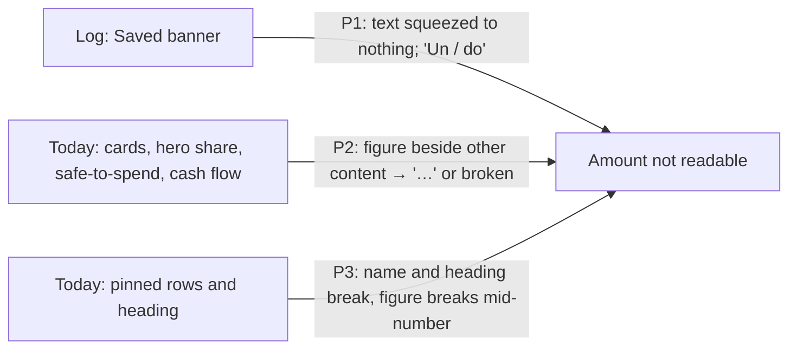

# Core flow round 5 — 15 October 2026: amounts stay whole at the largest text size

Baseline: `claude/today-hidden-amounts` at `0d5adf9` (round 2, #130), which
changes the same Today views; stacked on it for that reason. Release state is
not changed; App Store Connect state after the evidence recorded in
[CORE_FLOW_ROUND_2026-10-15.md](CORE_FLOW_ROUND_2026-10-15.md) is unknown.

## Why this round

The brief asks for amounts that stay readable at every Dynamic Type size. A
read-only audit of Today, Log and History at accessibility sizes found three
places where the figure itself is lost; History rows already have an
accessibility layout and are left alone. No existing test rendered Today or
the Saved banner at those sizes, so the round began with tests that do; the
Today render then showed four more places on the same screen with the same
fault, and they are fixed here too rather than left for a half-fixed Today.

## P1 — The Saved banner lost the amount it confirms

| Evidence | Effect |
|---|---|
| `QuickLogEntryChrome.swift` `savedEntryBanner`: one row of glyph, "Saved", "·", amount and category glyph under `.lineLimit(1)`, then favourite, Undo and Close, with no accessibility layout. Reproduced at the largest system text size on iOS 26.5 (UI journey below): the confirmation text is squeezed to nothing and "Undo" breaks as "Un / do"; Apple's clipped-text audit reports two clipped texts. | After saving at the largest size, the banner shows icons and a broken Undo; the amount just posted cannot be read. |

**Change.** At accessibility sizes the confirmation takes its own line and the
actions follow beneath it. The confirmation (`QuickLogSavedSummary`) stays on
one line where it fits; otherwise the amount moves to a line of its own and
may shrink to 40 % before it would ever be cut. The banner sits in the
digest-pinned Quick Log Chrome extension; it is re-pinned with a dated reason.

## P2 — Today's figures were cut or broken beside other content

| Evidence (render at AX5, `e9dde6a`) | Effect |
|---|---|
| `MoneyUpDisclosureCard` header (`MoneyUpDisclosure.swift`) put the summary beside a badge and a chevron; `positionSummary` and `monthlyBudgetCard` (`DashboardContent.swift`) put the one-line figure beside a 48–52 pt orbit. | Cash and debt read "SGD 12…", Monthly budget "SGD 10…". |
| The pinned hero's *Today* share (`DashboardPinnedHero.swift`) sat on one line with its glyph and label. | "SGD 430.6 / 1". |
| `safeToSpendSummary` (`DashboardSafeToSpend.swift`) put the title beside the figure. | "SGD 430…" and the title as "Fle / xi- / ble / to- / da / y". |
| `TodayCashFlowStory` put the net figure on as many lines as it needed, and each flow's amount beside its label. | "SGD" above "122,222.22"; Income as "123,456. / 78". |
| The Reports heading and the Private insights link put their title between a badge or glyph and a chevron; the cash-flow chart kept its axis labels and legend at a fixed 130-pt height. | "Re- / port / s and / in- / sight / s", "Pri- / vate / in- / sight / s"; axis labels and the legend overlapping (render after the first fix, `5f224fb`). |

**Change.** At accessibility sizes each title and each figure gets a line of
its own and the full width: a card's badge and chevron sit above its title,
the title above the summary, orbits below their figure, the safe-to-spend
title above its figure; the hero share, each flow and the pinned rows' Day /
Week / Month lines drop their amount beneath their label when the line does
not fit (`ViewThatFits`); the Reports heading and the Private insights rows
put their glyphs on a line above the words, and the cash-flow chart drops its
axis labels and legend (the Income and Spent figures under it carry the
values). Figures stay on one line and may shrink to 40–50 %,
hero figures to 35 %, which at these sizes is still larger than body text.
Standard sizes keep their layout (see Guardrails for the one exception).

## P3 — Pinned rows and their heading broke mid-word and mid-number

| Evidence (render at AX5) | Effect |
|---|---|
| `PinnedBudgetRow.headline` (`PinnedBudgetBoard.swift`): badge, name, spacer and figure in one row; only the cadence lines had an accessibility layout. The board heading put the pin glyph, title and menu in one row. | "SGD 10,7 / 65.4 / 4" for Food; the heading as "Pinne / d / cate- / gories". |

**Change.** At accessibility sizes the badge and name take one line and the
figure with *left* / *over* the next (one line, may shrink to 40 %); the
heading puts the glyph and menu above the title, which gets the row's width.

## Guardrails kept

- Layout only. Standard sizes keep their layout, with one exception: a Saved
  confirmation too long for its line (a long amount beside the favourite
  star on a narrow phone) now puts the amount on a second line instead of
  cutting it. Hero figures may shrink to 35 % instead of 50 % at
  accessibility sizes only. No ledger, money, formatting, masking or storage
  change.
- One reviewed Quick Log change (the Chrome extension's re-pin). No new
  strings, dependencies or permissions.

## Verification

Reproduction first (`f6715dd`, `3f1c108`, `e9dde6a`: tests only, app code = #130):

- UI journey `testLargestTextSizeKeepsTheSavedAmountWhole` (iPhone 17 Pro,
  iOS 26.5, `UICTContentSizeCategoryAccessibilityXXXL`): failed as expected,
  two clipped texts; screenshot `journey-ax5-saved-banner`.
- Render `testTodayKeepsEveryAmountWholeAtTheLargestTextSize` (iOS 18.5,
  AX5, 320 and 390 pt, Vision). Getting a real picture took two corrections,
  both tests only: the first render was black, and so was a 2x render with a
  blank-render guard (`3f1c108`): a window this far past the screen is not
  composited, so `drawHierarchy` draws nothing. `e9dde6a` draws the hosting
  view's layer tree instead. That run failed as expected:
  `320 pt: SGD 10,765..., 430.61, 56.78, cash 122,222.22 not whole` and
  `390 pt: 122,222.22, 1,234.56, SGD 10..., 430...` — every place listed in P2
  and P3.

With the fix: the same two tests, plus the Saved confirmation rendered at the
widths it gets on 320 and 390 pt phones at AX5 (the amount read back whole).

Swift was not compiled or run in the authoring environment (Linux); every
`Scripts/validate_*.py` passes there.

## Device checklist (owner, signed build)

1. Settings → Accessibility → Larger Text at the largest size: save an entry
   in Log and read the Saved banner; Undo is one word.
2. Today with long figures: Cash and debt, Monthly budget and the pinned rows
   show every figure whole, at 320 pt (iPhone SE) and a 6.1" phone.
3. Back at the default size, nothing has moved.

## Not changed (next)

- The arithmetic sheet and the foreign-currency notices stay readable but can
  break a long figure; the Log amount field is one line and may show a long
  amount's tail as "…" when not focused.
- The test reads lines from pixels: a word SwiftUI breaks without a hyphen
  is not caught, and the screen was checked by eye in the attached renders.
- Secondary sheets were not audited at accessibility sizes.
