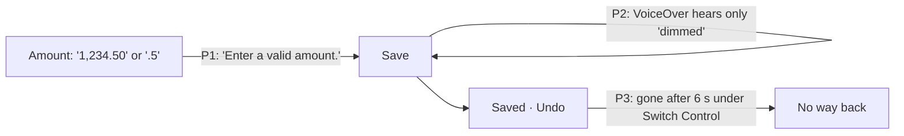

# Core flow round 4 — 15 October 2026: Log reads what you meant and says why it waits

Baseline: `claude/core-flow-polish` at `9c51f7f` (round 1, #129), which
introduced the shared amount rule this round extends. Stacked on #129 for that
reason; independent of rounds 2 (#130) and 3 (#131). Release state is not
changed; App Store Connect state after the evidence recorded in
[CORE_FLOW_ROUND_2026-10-15.md](CORE_FLOW_ROUND_2026-10-15.md) is unknown.

## Why this round

A read-only audit re-checked round 1's Log backlog against the source. Three
problems share one moment, the second before Save: the amount is refused
although it has one reading, Save is dimmed without a word for VoiceOver, and
the Undo that follows can vanish before a Switch Control user reaches it.

## P1 — Amounts with one reading were refused

| Evidence (`9c51f7f`) | Effect |
|---|---|
| `writtenAmount` (`DisplayFormatting.swift`) accepted `^[+-]?[0-9]+(SEP[0-9]+)?$` only: no grouping and a digit before the separator. Every amount field uses it (Log, the editor, splits, balances, goals, loans). | Pasting "1,234.50" from a bank message, or typing ".5" (the decimal pad offers "." first), showed *Enter a valid amount.* and kept Save dimmed. Smart Entry already read "1,250.00". |

**Change.** A grouped amount is read when it has only one reading in the
device's locale: it has a decimal part ("1,234.50"; "1.234,50" in German) or
two or more groups of three ("1,234,567"). A typed space counts as the
locale's no-break or narrow space ("1 234,50" in French). A leading separator
is a fraction of one (".5", ",5"), and "." alone is the start of one rather
than an error while typing.

**Kept (M1, [AUDIT_2026-09-25.md](AUDIT_2026-09-25.md)).** One group alone
("1,234" in English, "1.000" in German) could be a decimal in the other
convention and is still refused, as are grouping not in threes, mixed
conventions, symbols, and anything past the currency's minor units
("1,234.567" in USD). Amounts stay `Decimal`; no text is rounded.

**Acceptance.** "1,234.50" and ".5" save exactly 1234.50 and 0.50 in a USD
account; "1,234" and German "1.000" still say *Enter a valid amount.*

## P2 — A dimmed Save had no reason for VoiceOver

| Evidence (`9c51f7f`) | Effect |
|---|---|
| `LogSaveBar` (`QuickLogEntryChrome.swift`) only had `.disabled(!canSave)`; `canSave` (`QuickLogSheet.swift`) was a Bool over a dozen conditions. | A sighted person sees the empty amount or the category placeholder; VoiceOver said *Save, dimmed* and nothing about what was missing. |

**Change.** `saveBlocker` names the first thing missing, in the order the form
is filled (still working, Smart Entry note, amount, account, category or split,
allowance rule, receiving account, amount received), and `canSave` is now
exactly *no blocker*, so the two cannot disagree. The dimmed button's
accessibility value says it, reusing the existing wording where it exists
(*Enter or confirm the amount.*, *Choose the receiving account.*) and four new
bilingual strings otherwise.

**Acceptance.** VoiceOver on an empty Log: *Save, Enter or confirm the
amount., dimmed*. A transfer without a destination: *Choose the receiving
account.*

## P3 — Undo disappeared before Switch Control reached it

| Evidence (`9c51f7f`) | Effect |
|---|---|
| `completeSuccessfulSave` (`QuickLogEntryCommit.swift`) hid the Saved banner after 6 s unless VoiceOver was on. | Switch Control users scan to Undo element by element; six seconds is often not enough, and a wrong save then needs History. |

**Change.** The banner stays for Switch Control as it does for VoiceOver,
until dismissed. iOS gives apps no signal for Voice Control, so that case is
unchanged and listed below.

## Reviewed Quick Log change

`QuickLogEntryBody.swift`'s `QuickLogEntryView` extension is digest-pinned
(`Scripts/validate_architecture_fitness.py`, W3). The only change inside it is
one argument at the Save bar's call site (`blocker: saveBlocker`); the pin is
updated with a dated reason, as earlier re-pins are. The Chrome extension's
pin is unchanged: the new code is outside it.

## Guardrails kept

- M1 ambiguity refusals, currency precision and the new-write ceiling are
  unchanged; every caller of the shared rule was checked (hand-typed fields
  only; no import or OCR path uses it).
- No ledger, posting or storage change; no dependency, permission or
  telemetry. Four new bilingual strings.

## Verification

- App (`LogInputAndSaveTests`, +3): grouped and leading-separator amounts in
  `en_US`, `de_DE`, `fr_FR` (typed and narrow space) and `de_CH`, exact
  `Decimal` values and scales; currency scale after grouping; the ambiguous
  and malformed forms that stay refused (including M1's IDR and VND cases);
  every Save reason worded in both languages. Three existing assertions
  change deliberately: round 1's invalid list keeps "1,234" instead of
  "1,234.50"; "." becomes an incomplete prefix while typing; and French
  "1 000,50" is read as 1000.50 (the test guards against reading part of the
  string, and now also refuses "1 000" and "1 00,50").
- UI journey (+1, iOS 26.5): an empty Log's dimmed Save carries *Enter or
  confirm the amount.*; ".5" shows no error, enables Save and saves; a transfer
  without a destination carries *Choose the receiving account.*
- All `Scripts/validate_*.py` and the architecture validator's 58 self-tests
  pass locally (Linux, no Swift); compile and test evidence comes from CI.

## Device checklist (owner, signed build)

1. Paste "1,234.50" from Notes into Log's amount; type ".5". Try "1,234" and,
   with the region set to Germany, "1.000": both still refused.
2. VoiceOver: focus the dimmed Save on an empty Log, then with only the
   category missing, then on a transfer without a destination.
3. Switch Control: save an entry and reach Undo after more than six seconds.

## Not changed (next)

- Voice Control has no public API; Undo still hides after 6 s for it.
- The Saved banner truncates its amount at accessibility text sizes (pinned
  Chrome extension; needs a layout change and a re-pin).
- The entry date resets to now after each save (needs a carried-date rule the
  draft and preload policies respect).
- Indian grouping ("12,34,567.50") is not read; it is refused as before.
