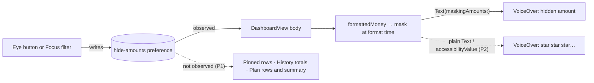

# Core flow round 2 — 15 October 2026: hidden amounts stay hidden and silent

Baseline: `main` at `1163b61` (0.7.4 expressive pass, #126). Round 1 (#129)
touches Log, History and Edit and shares no file with this round. Release
state is not changed here; the last App Store Connect evidence available is
the one recorded in [CORE_FLOW_ROUND_2026-10-15.md](CORE_FLOW_ROUND_2026-10-15.md),
and anything after it is unknown.

## Why this round

Amounts are hidden by default, and the eye button on Today (or a Focus filter)
is how a person shows them for a moment and hides them again, often with
someone beside them. Round 1's audit left three Today findings in its *Next
round* list; all three are about what Today says while amounts are hidden.

Masking happens while a figure is formatted, so a view that formats amounts in
its own `body` is only masked when that body runs again. SwiftUI skips a
child's body when its inputs are unchanged, and none of a row's inputs change
when only the preference does.

## P1 — Hiding amounts left figures on screen and in VoiceOver

| Evidence on `main` | Effect |
|---|---|
| `PinnedBudgetBoard.swift:121` `PinnedBudgetRow` formats its figures in its own body and does not observe `MoneyAmountPrivacy.storageKey`. Reproduced in the real app on iOS 26.5 (UI journey below): after *Hide amounts* the row still read `$551.50` and `Day, $32.44`. | The pinned row kept showing exact figures, on screen and to VoiceOver, until something else redrew it. |
| `DashboardPinnedHero.swift:55,81` combined the hero for VoiceOver *around* `MoneyUpCard`, which is itself an accessibility container. Same run: the hero's own texts said *hidden amount*, but the combined element VoiceOver reads still said `Left this month, $551.50, … Today, $32.44`. Every other Today card combines *inside* its card and updated correctly. | VoiceOver users heard the exact figures the screen had just hidden. |
| `HistoryFilters.swift:6` `HistorySummaryView`, `PlanView.swift:189` `BudgetRow` and `:330` `BudgetSummaryCard` have the same structure as the pinned row. **Not reproduced:** the iOS 18.5 render test below hid every figure on Today, History, Plan and Assets on `main`, and the journey covers Today only. | Same risk as the pinned row; changed for consistency, not on evidence of a leak. |

**Change.** The four views observe the preference, the pattern
`DashboardView` already uses, so they redraw the moment amounts are hidden or
shown. The hero combines its content inside the card, as the other cards do.

**Acceptance.** On a budgeted Today, show amounts, then hide them: no figure
that was shown remains anywhere in the accessibility tree.

## P2 — VoiceOver read the mask aloud

| Evidence on `main` | Effect |
|---|---|
| `DashboardContent.swift:362` (next payment), `DashboardSafeToSpend.swift:133` (the 7-day line), `DashboardContent.swift:201` (other-currency balances), `MoneyUpDisclosure.swift:175,181` `MoneyUpFigure` (cash, debt, net), `DashboardView.swift:341` (the safe-to-spend arithmetic) put the masked string in plain `Text` or an accessibility value. | VoiceOver read the mask's asterisks aloud in these five places, while everywhere else it says "hidden amount". |

**Change.** `MoneyAmountPrivacy.spoken(_:)` turns each mask into *hidden
amount* / *隐藏的金额*; `Text(maskingAmounts:)` now uses it, and the five
places use either.

**Acceptance.** With amounts hidden, the accessibility tree of a budgeted Today
holds no `*****`.

## P3 — Over budget, the hero said "Left this month"

| Evidence on `main` | Effect |
|---|---|
| `DashboardPinnedHero.swift:57-62` always titled the hero *Left this month* and showed the negative remainder in amber. | Over budget, Today's largest line read *Left this month −S$150*. With amounts hidden it read *Left this month \*\*\*\*\**, so being over was carried by colour alone, and in amber while the rows below show the same overspend in the danger colour. |

**Change.** Over budget, the hero reads *Over this month* / *本月超支* with
an alert glyph and how far over as a positive figure, in the danger colour:
what the pinned rows (`plan.over`) and Plan (`plan.total_over`) already say.
Under budget nothing changes.

**Acceptance.** S$650 spent of S$600 with amounts hidden: the hero says *Over
this month*, never *Left this month*. Exactly at the limit (S$0 left) it
still says *Left this month*.

## Guardrails kept

- Display only. No ledger, budget arithmetic, `Decimal` handling, currency,
  storage or migration change; `PinnedRemainingHero.make` is unchanged and
  the hero shows `remaining.negated` exactly as the rows below it do.
- No new dependency, permission, telemetry or network. One new bilingual
  string (`today.hero.over_month`).
- The default UI-test book is unchanged; the budgeted book is opt-in
  (`-MoneyUpUITestBudgetedBook`) and fictional.

## Verification

Reproduction first: commit `758bcba` adds the tests alone, against `main`'s
app code. Its CI is the *before* evidence:

| Test on `758bcba` (app code = `main`) | Result |
|---|---|
| `AmountPrivacyRenderTests.testHidingAmountsHidesEveryFigureAlreadyOnEachPrimaryTab` — hosted render, iPhone 16 Pro, iOS 18.5 ([run 38691196502](https://github.com/LaiWenKang/MoneyUp/actions/runs/38691196502)) | **Passed**: every figure masked after the toggle on all four tabs. The hosted render does not reproduce P1; kept as a guard. |
| `testHidingAmountsOnABudgetedTodayHidesAndSilencesEveryFigure` — real app, real eye button, iPhone 17 Pro, iOS 26.5 ([run 38691196521](https://github.com/LaiWenKang/MoneyUp/actions/runs/38691196521)) | **Failed as expected**: `Still shown after hiding: 32.44, 551.50` (pinned row, and the hero's combined VoiceOver label). The attached tree also holds the next payment read as `*****` (P2); the second assertion never ran because the first stops the test. |

Why the hosted render on iOS 18.5 redraws the rows while the app on iOS 26.5
does not is not established; the fix does not depend on it.

Tests that ship with the fix:

- The two above, which must now both pass.
- The over-budget hero in words with amounts hidden (render, English); the
  hero's title and amount at −150, 0, 0.01 and 551; the spoken mask.
- Swift was not compiled or run in the authoring environment (Linux); every
  `Scripts/validate_*.py` passes there. Compile, unit, render and UI evidence
  comes from the pull request's macOS CI.

## Device checklist (owner, signed build)

1. Today with pinned budgets: show amounts, hide them; every row hides at once.
   Repeat on History (totals) and Plan (rows and summary).
2. VoiceOver on Today with amounts hidden: the next payment, the 7-day line,
   cash and debt and the arithmetic sheet say *hidden amount*.
3. Spend past a pinned limit: the hero says *Over this month* / *本月超支*,
   in English and Chinese, light and dark, at the largest Dynamic Type size.
4. A Focus filter that hides amounts: switch it on while Today is open.

## Residual and next round (not changed here)

- About thirty views outside the primary tabs (mostly sheets: account detail,
  goal detail, category drill-ins) format amounts without observing the
  preference. A sheet is rebuilt when it opens, so this only matters if the
  preference changes while one is open (a Focus filter switching on). Moving
  masking from format time into one observing view modifier would close it
  for good; that is a wider change than this round.
- History: editing or deleting past the first page returns to page 1; amounts
  written as a row shows them ("28.80", "$12") are not found.
- Log: the Saved banner truncates at accessibility sizes; the date resets
  after every save; a dimmed Save gives VoiceOver no reason.
